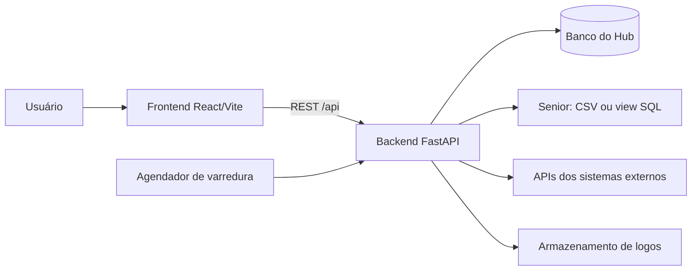
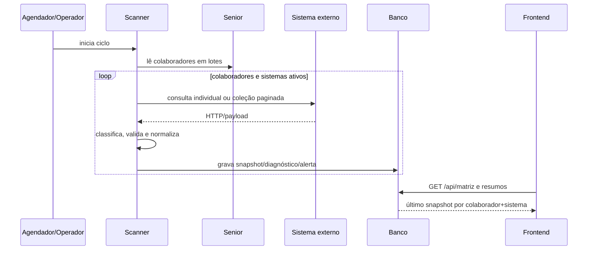

# Arquitetura

## Visão em camadas

## Componentes

### Frontend — `HUB_acesso_Frontend`

É uma SPA React 19 com TypeScript e Vite. Sua responsabilidade é navegação, filtros, apresentação da matriz, administração e interação do auditor. O frontend usa `src/services` como camada de acesso HTTP e mantém a maior parte do estado de tela em `App.tsx`.

### Backend — `HUB_acesso_Backend`

É uma API FastAPI. Centraliza:

- leitura e validação dos colaboradores do Senior;
- cadastro das integrações e versões de contrato;
- chamadas às APIs externas;
- validação e normalização dos payloads;
- persistência de snapshots, estados agregados, alertas e diagnósticos;
- endpoints de consulta usados pelo frontend;
- varredura manual e automática.

### Persistência

SQLAlchemy fornece o modelo e a sessão. SQLite é adequado para desenvolvimento/testes; PostgreSQL é o alvo de produção. O startup apenas verifica conexão/schema. Alterações estruturais são feitas pelo script explícito de preparação/migration.

### Fontes de dados

`SeniorDataSource` é a abstração. `CsvSeniorDataSource` e `SqlSeniorDataSource` implementam o mesmo contrato, permitindo trocar a origem sem mudar o scanner ou as rotas.

## Fluxo principal de dados

## Fronteiras e regras de responsabilidade

| Responsabilidade | Camada correta |
| --- | --- |
| Consultar fonte Senior | backend/data source |
| Consultar APIs externas | backend/scanner |
| Validar JSON Schema | backend/mapping |
| Interpretar HTTP e timeout | backend/scanner/diagnostics |
| Decidir o último snapshot | backend/queries |
| Formatar dados para a tela | frontend/services e componentes |
| Definir regra de segurança | backend/audit |
| Aplicar filtro visual e navegação | frontend |

## Concorrência e ciclo de vida

O ciclo automático roda fora do event loop principal, em thread própria, para não bloquear `/health` e as demais rotas. A mesma `asyncio.Lock` é compartilhada com o endpoint manual, evitando duas varreduras simultâneas. No encerramento, o agendador é cancelado de forma limpa.

## Decisões importantes

- Sistemas ativos são as colunas correntes da matriz; snapshots antigos de sistemas inativos continuam disponíveis para auditoria.
- Sistemas de desenvolvimento (`localhost`, loopback, `.local` e `.test`) podem aparecer na matriz, mas não entram nos indicadores operacionais.
- Para escolher o estado atual, o backend usa o snapshot mais recente por chave composta de colaborador e slug do sistema.
- A chave do colaborador não é o CPF: é `empresa|filial|tipo|matrícula`.

