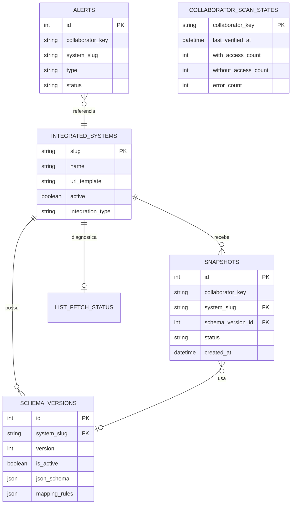

# Banco de dados, migrations e recuperação

## Diagrama lógico



## Tabelas e uso

| Tabela | Papel | Histórico? |
| --- | --- | --- |
| `integrated_systems` | cadastro operacional | estado atual |
| `schema_versions` | contratos por sistema | sim |
| `snapshots` | resultado de cada consulta | sim, crescimento alto |
| `collaborator_scan_states` | agregado corrente por colaborador | não, sobrescrito |
| `list_fetch_status` | último diagnóstico de coleta em lista | não, sobrescrito |
| `alerts` | ocorrências de auditoria | sim, uma ocorrência por chave/tipo |

## Campos relevantes

### `integrated_systems`

`slug` é a chave estável; `url_template`, `timeout_seconds`, `active`, `api_key`, `auth_type`, `auth_header_name`, `logo_path`, `integration_type`, `page_param`, `limit_param`, `page_size`, `cpf_field`, `http_method`, `absence_code` e `display_order` controlam a integração e sua apresentação.

### `schema_versions`

`json_schema` valida a resposta da origem; `mapping_rules` a converte para o modelo normalizado. `system_slug + version` é único.

### `snapshots`

`collaborator_key`, `system_slug`, `status`, `http_status`, `response_time_ms`, `collaborator_data`, `raw_payload`, `normalized_payload`, `validation_errors`, `error_detail`, `failure_cause`, `warning_detail` e `created_at` formam a evidência da consulta.

## Índices e consultas críticas

O índice `ix_snapshots_collaborator_latest` em `(collaborator_key, created_at DESC, id DESC)` permite recuperar o snapshot mais recente. Há índices em chaves de colaborador, sistema, status e datas.

Em PostgreSQL de alto volume, aplicar como migration os índices de expressão sugeridos no README do backend: `pg_trgm`/GIN para busca textual em JSON e B-tree para empresa, filial e cargo. `CREATE INDEX CONCURRENTLY` deve ser executado fora de transação.

## Preparação atual do schema

`scripts/prepare_database.py` chama `prepararBancoDados()`. O procedimento:

1. cria tabelas ausentes com `Base.metadata.create_all`;
2. verifica colunas adicionadas ao longo do protótipo;
3. adiciona colunas legadas ausentes com `ALTER TABLE`.

O startup usa `verificarBancoDados()` e não corrige o banco. Isso evita mutações silenciosas, mas não substitui uma ferramenta de migration versionada em produção.

## Procedimento de mudança de schema

1. Alterar o modelo SQLAlchemy.
2. Atualizar `prepararBancoDados()` somente para compatibilidade transitória, se necessário.
3. Criar migration versionada para produção.
4. Testar em banco vazio e banco legado.
5. Fazer backup antes da mudança.
6. Aplicar migration no ambiente de homologação.
7. Executar smoke test de `/ready`, matriz, alertas e varredura.
8. Promover para produção.

## Backup e restauração PostgreSQL

Exemplos operacionais; ajustar host, usuário e política de segredo:

```powershell
pg_dump --format=custom --file=hub-acessos-YYYYMMDD.dump "$env:DATABASE_URL"
pg_restore --list hub-acessos-YYYYMMDD.dump
```

A restauração deve ocorrer em banco separado primeiro, seguida de validação de contagem de sistemas, versões, snapshots e alertas. Não restaure diretamente sobre produção sem janela aprovada e plano de rollback.

## Retenção

O sistema atual não implementa retenção automática. A operação deve definir prazo por tipo de dado, por exemplo snapshots detalhados, payloads brutos e alertas resolvidos. Qualquer limpeza precisa preservar evidências exigidas por auditoria e ser testada em cópia.

